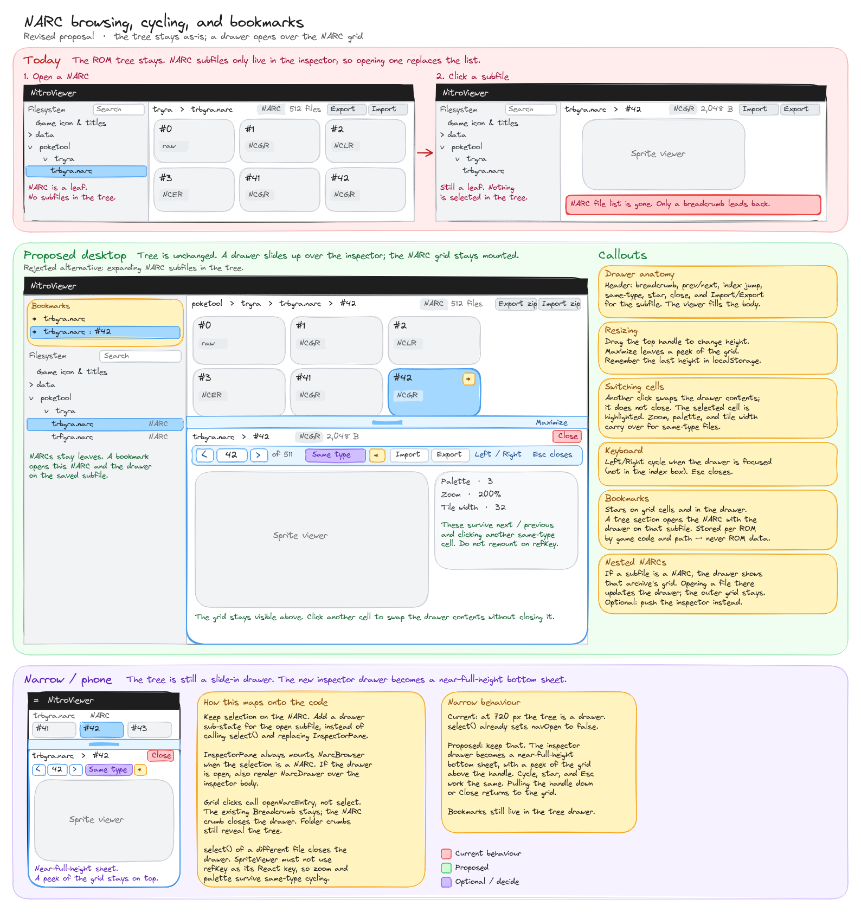

# NARC browsing, cycling, and bookmarks

Hand-drawn wireframe of the proposal. It contains no ROM data. The scene opens in
[narc-browsing.excalidraw](narc-browsing.excalidraw).

## Problem

Clicking a NARC subfile in `NarcBrowser` calls `select()` (`NarcBrowser.tsx:152`). `InspectorPane` treats a
selection whose format is `NARC` as `isNarc` (`InspectorPane.tsx:148`) and mounts `NarcBrowser` only on that
branch (`:184`). The subfile selection replaces the grid with the viewer, so the file list disappears and
the breadcrumb is the way back. The NARC crumb calls `select()` on the archive (`InspectorPane.tsx:116`).

A subfile leaves no tree row highlighted. `rowSelected` in `treeSearch.ts` matches only `ROM_CONTAINER`
(`treeSearch.ts:27`).

On a narrow screen `select()` also sets `navOpen` to false (`store.ts:587`), which closes the tree drawer.

Discord asked for NARC browsing and cycling (Adcroc1) and for bookmarking a NARC or a subfile (hamesbond).

## Design

The tree stays as it is, and NARCs stay leaves.

A grid click opens the subfile in a drawer that slides up from the bottom of the inspector. `NarcBrowser`
stays mounted above the drawer, and the open cell stays highlighted. Another cell swaps the drawer
contents and leaves the drawer open. Clicking the cell that is already open reloads that subfile from the
saved bytes.

The drawer header holds the breadcrumb, previous and next, an index box, a same-type toggle, a bookmark
star, Import and Export for the subfile, and Close. A drag handle sets the height, and Maximize leaves a
peek of the grid. One height is remembered for every NARC, in localStorage, on the same pattern as
`nitroviewer.treeWidth` (`TREE_WIDTH_KEY` in `store.ts`).

Left and Right cycle whenever the drawer is open, including when focus is elsewhere in the page. They use
the same guard as `typingTarget` in `App.tsx` (`:107`), so typing in the index box or another field does
not cycle. Esc closes the drawer.

Zoom, palette, and tile width survive a cycle onto another file of the same type. A key of `refKey` or of
`refKey:editVersion` both change when the open file changes, so either one remounts the viewer and drops
that state. `InspectorPane` builds `` `${refKey(selection.ref)}:${editVersion}` `` (`:181`) for most
viewers. `SpriteViewer` (`:191`), `MultiCellViewer` (`:193`), `BmgViewer` (`:195`), `FontViewer` (`:197`),
and `SoundViewer` (`:203`) are keyed by `refKey` alone, so an import of the same file keeps tile width,
palette, and zoom. Cycling has to keep that view state across a new ref, and an edit still has to show the
new bytes.

Cycle, close, and a re-click of the open cell go through the existing `confirmDiscardDraft` /
`useDraftEditor` flow when a draft is dirty. That is the only discard path.

A nested NARC gets a tab selector at the top of the inspector, one tab for the main view and one for the
subview. Switching tabs keeps each view's scroll, so each view has its own scroll state. Today `narcScroll`
and `trackNarcScroll` (`NarcBrowser.tsx:15`) read and write the single `.inspector-body` scroller.
`SdatTabBar` in `SoundViewer.tsx` (`:602`) is the tab bar to follow.

A star sits on each grid cell and in the drawer header. A Bookmarks section sits at the top of the tree,
beside the Game icon & titles pin (`TreePane.tsx:134`). Opening a subfile bookmark selects that NARC and
opens the drawer on that index. Bookmarks are stored per ROM in localStorage, keyed by `romInfo.gameCode`
and a path such as `/poketool/trgra/trbgra.narc` or `/poketool/trgra/trbgra.narc:#42`. Each entry is that
key, plus an optional rename and an optional note. The entry holds no ROM bytes.

At the 720px layout (`styles.css:579`) the inspector drawer becomes a near-full-height bottom sheet, with a
peek of the grid above the handle. The tree hamburger drawer is unchanged.

The NARC breadcrumb crumb closes the drawer.

## Code-change sketch

- `store.ts`. A drawer sub-state holds the open entry's ref, name, format, and size, plus the height and
  the maximized flag. Actions are `openNarcEntry`, `closeDrawer`, and the height and maximize setters.
  `select()` of a different file closes the drawer. A grid click calls `openNarcEntry` and leaves
  `select()` alone.
- `InspectorPane`. A NARC always mounts `NarcBrowser`. The pane renders a new `NarcDrawer`, and the tabs
  for a nested NARC.
- `NarcBrowser`. Cell clicks call `openNarcEntry`, the open cell is highlighted, and cells show stars.
- `TreePane`. The bookmarks section goes at the top of the scroll area, beside the banner pin.
- Viewers. View state survives a same-type cycle, with the keying in the design section fixed so an edit
  still refreshes the bytes.
- `styles.css`. The drawer, and the bottom sheet inside the existing 720px query.

## Quality gate

High-CRAP functions are not to be avoided. The crapper gate exists to clean the code up, so put each change
where it belongs and split and test whatever it touches. New or changed functions stay under a CRAP of 10,
an existing function's CRAP does not rise, and a new dryer pair fails the build (`.quality/README.md`).

Baseline CRAP from `.quality/crap-baseline.json` for the functions this work hits. `App` is listed for the
keyboard handling.

| Function | Path | CRAP |
| --- | --- | --- |
| `NarcBrowser` | `web/src/components/NarcBrowser.tsx` | 930 |
| `InspectorPane` | `web/src/components/InspectorPane.tsx` | 702 |
| `TreePane` | `web/src/components/TreePane.tsx` | 240 |
| `Breadcrumb` | `web/src/components/InspectorPane.tsx` | 110 |
| `ImportButton` | `web/src/components/InspectorPane.tsx` | 42 |
| `ExportButton` | `web/src/components/InspectorPane.tsx` | 20 |
| `App` | `web/src/App.tsx` | 5112 |
| `SpriteViewer` | `web/src/components/SpriteViewer.tsx` | 23256 |
| `MultiCellViewer` | `web/src/components/MultiCellViewer.tsx` | 3306 |
| `PaletteViewer` | `web/src/components/PaletteViewer.tsx` | 1640 |
| `FontViewer` | `web/src/components/FontViewer.tsx` | 1056 |
| `BmgViewer` | `web/src/components/BmgViewer.tsx` | 650 |
| `SoundViewer` | `web/src/components/SoundViewer.tsx` | 26082 |
| `ModelViewer` | `web/src/components/ModelViewer.tsx` | 5557.6802 |
| `useDraftEditor` | `web/src/useDraftEditor.ts` | 272 |
| `confirmDiscardDraft` | `web/src/state/store.ts` | 13.2592 |

`SpriteViewer` and `MultiCellViewer` already form dryer pairs for `RefSelect` and for `Stepper`
(`.quality/dry-baseline.json`). Those pairs stay. A new pair fails the gate.

## Related debt

From `HANDOFF.md`:

- No browser history, around line 647 ("browser Back leaves the app"). The drawer, the tabs, and cycling
  share that gap. Deep links such as `#/path/file.narc/42` come later.
- The top bar is cramped on narrow screens and iOS, around line 635 ("mobile/iOS header crowding").
- Redo does not restore a sprite pencil stroke, around line 640. That bug sits on the same draft stack as
  the discard prompt.

## Suggested PR sequence

Small PRs, each one passing the gates:

1. Splits and tests for the components this work touches.
2. The drawer and cycling.
3. Tabs for nested NARCs.
4. Bookmarks.

Split a step further if a smaller cut shows up while doing the work.

## Open questions

- How much of the grid stays visible when the drawer is maximized.
- Whether the main breadcrumb shows `#42` while the drawer is open.
- Whether history and deep links land with this work or after it.
